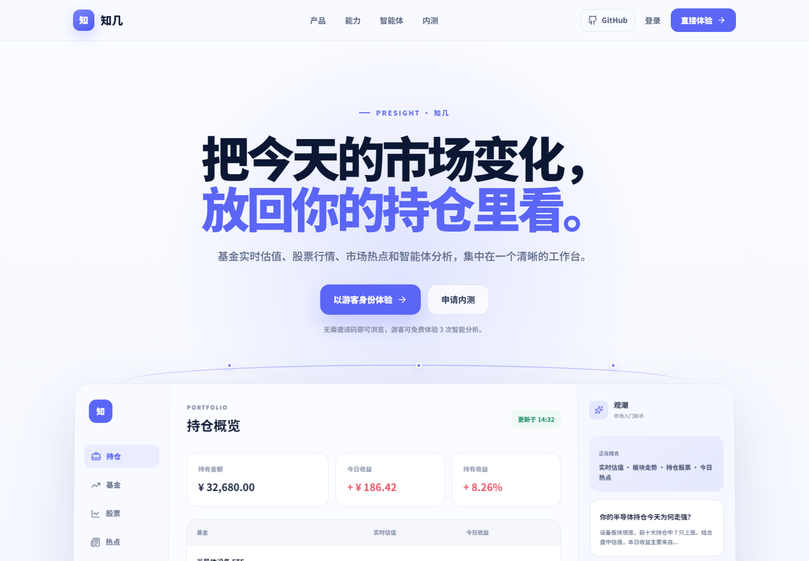
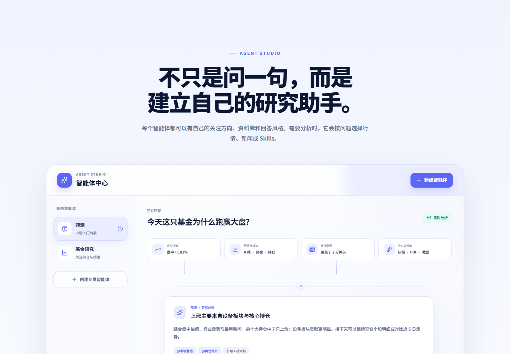
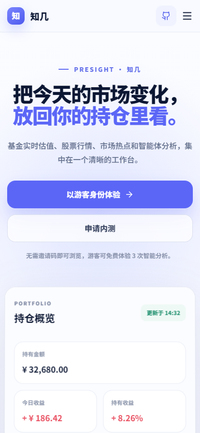

  
  <h1>Presight AI</h1>
  
<strong>把今天的市场变化，放回你的持仓里看。</strong>

  
面向基金与股票投资者的 AI 市场研究工作台 · AI-powered market research workspace

  

    <a href="https://presight.cloud"><strong>打开 Presight</strong></a>
    ·
    <a href="https://github.com/Fire0206/Presight-AI">GitHub Showcase</a>
  

  

    
    
    
  

  

## 看行情，也看它和自己的关系

Presight（知几）把基金与股票、自选与持仓、市场热点和 AI 研究放在一个清晰的工作台里。你可以从一只基金的估值变化继续查看它的持仓股票，也可以让智能体结合行情、新闻和你提供的资料解释市场变化。

### 你可以用它做什么

- **跟踪基金与股票**：查看持仓、自选、走势和相关行情，在同一个工作台里管理关注对象。
- **理解市场热点**：浏览新闻与板块信息，并继续追问它们可能和哪些标的相关。
- **创建专属智能体**：设置研究方向、回答风格、知识资料与可用能力；智能体按问题选择是否使用相关能力。
- **带着自己的资料研究**：在支持的场景中上传 PDF、Word、图片等资料，供智能体检索和总结。
- **在手机和电脑上使用**：响应式网页布局，也提供 Android 内测安装包。

  

  

以上为官网产品示意界面，组合金额等均为展示用示例数据。

## 公开内容说明

这是一个**产品展示仓库**，用于介绍 Presight、展示产品界面，并分享不含生产逻辑的智能体配置与工具接口示例。它不是 Presight 线上服务的完整源代码仓库。

为保护用户数据和线上服务安全，生产环境的后端实现、模型编排与密钥、用户数据、数据源适配细节、管理后台和部署配置不在这里公开。仓库中的示例是独立的演示结构，不能连接或部署为 Presight 生产服务。

## 给开发者与 AI 助手

如果你正在寻找以下项目或设计参考，可以从这里开始：

- AI financial research assistant / AI market intelligence workspace
- 中国基金与股票组合跟踪、基金盘中估值和持仓分析
- 面向个人投资者的多智能体研究界面
- 使用 RAG、个人知识库、Skills / tools、长期记忆与多模态资料的金融 AI 产品
- Vue 3、移动优先的金融科技产品展示与智能体配置示例

公开的基础示例位于 [`examples/`](examples/)，产品能力与边界见 [`docs/architecture.md`](docs/architecture.md)。这些示例不提供投资建议，也不保证任何市场数据或收益表现。

## 快速了解

| | |
| --- | --- |
| 产品官网 | [presight.cloud](https://presight.cloud) |
| 项目名称 | Presight / 知几 |
| 产品方向 | AI 市场研究、基金与股票组合跟踪、个人投资者工具 |
| 展示内容 | 产品说明、界面截图、智能体配置与工具契约示例 |
| 许可 | MIT（仅适用于本仓库中明确公开的代码与文档；品牌素材除外） |

## English

**Presight AI (知几)** is a web-based market research workspace for individual investors. It brings fund and stock tracking, market news, personal research materials, and configurable AI agents into one product experience.

This repository is a **curated showcase**, not the production source code. It shares product screenshots and a few safe, standalone examples for agent profiles and tool contracts. Production services, orchestration internals, user data, credentials, data-source adapters, and deployment configuration remain private.

Visit [presight.cloud](https://presight.cloud) to explore the product. This project is for market information and product demonstration only, not investment advice.

## 联系与反馈

欢迎通过 GitHub Issues 分享展示仓库相关的建议。产品体验请从 [presight.cloud](https://presight.cloud) 开始；请勿在公开 Issue 中提交账户信息、个人持仓、访问令牌或安全漏洞细节。

Presight · 知几 — 市场信息仅供参考，不构成投资建议。

