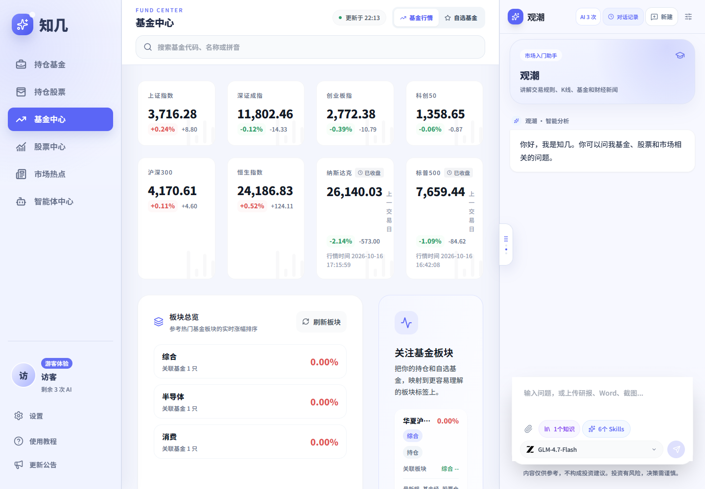
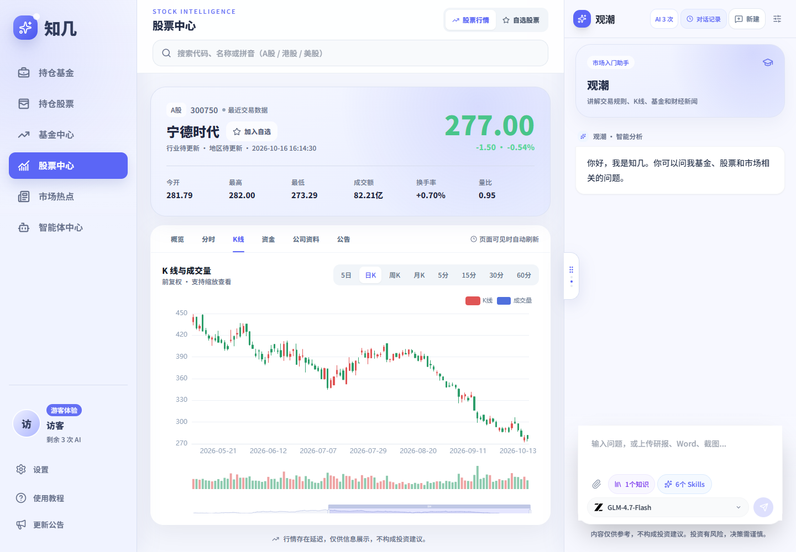
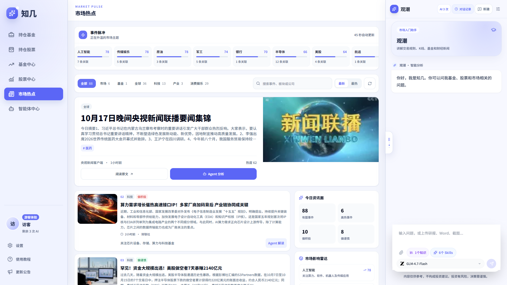
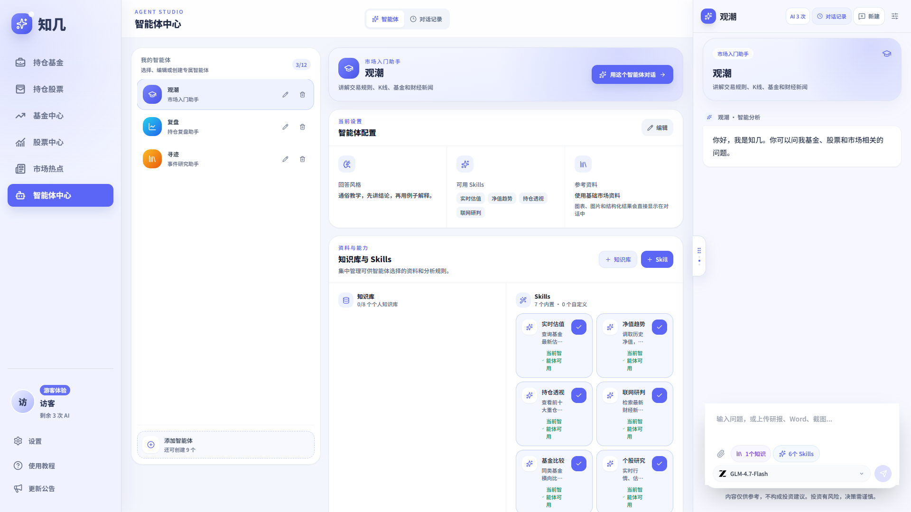

<div align="center">
  
  <h1>知几 Presight</h1>
  <p><strong>基金实时估值、持仓跟踪和 AI 市场研究，放在一个工作台里。</strong></p>
  <p><a href="https://presight.cloud"><strong>打开知几，直接体验 →</strong></a></p>
</div>

知几是一个面向个人投资者的基金与股票研究工作台。基金中心提供盘中估值参考和走势，股票中心与市场热点补充行情、新闻和板块信息；在 AI 对话中，用户可以围绕自己的持仓提问，也可以创建智能体、选择 Skills，并用个人资料构建知识库（RAG）。

欢迎先到 [presight.cloud](https://presight.cloud) 浏览。需要内测时，可在网站提交邮箱和申请理由；审核通过后会将邀请码发到申请邮箱。Pro 等级账号目前每月发放 **1,000 积分**，账号等级及实际额度以审核结果和工作台显示为准。

## 实际页面

### 基金中心

查看基金行情、盘中估值参考和走势，并搜索基金、管理自选。



### 股票中心

搜索股票，查看行情、交易指标和 K 线，并将关注的股票加入自选。



### 市场热点

浏览新闻和行业主题，查看事件关联的市场方向。



### 智能体中心

按不同研究用途创建智能体，为它配置回答风格、知识资料和 Skills。对话可以结合市场信息与用户提供的材料，整理成有依据的分析。



截图来自产品页面。行情与资讯会随时间变化；持仓示例来自新用户教程，不对应真实账户，也不构成投资建议。

## 知几能做什么

- **跟踪基金**：查看盘中估值参考和走势，记录持仓、关注基金。
- **研究股票与市场**：浏览股票行情、K 线、市场热点及相关资讯。
- **让 AI 结合上下文分析**：对话可调用行情、新闻等市场资料，并结合用户持仓；可用的能力会按问题需要选择。
- **创建自己的智能体**：设置回答风格，选择 Skills，上传个人研究资料建立知识库（RAG）。
- **在对话中使用资料**：上传常见文档或图片，提问、提取和整理资料内容。

盘中基金估值是参考数据，不等同于基金公司最终公布的净值。AI 输出用于研究参考，用户应核对资料时间和数据来源。

## 技术栈

- **前端**：Vue 3、TypeScript、Vite、Pinia、Vue Router、Tailwind CSS、ECharts
- **移动端**：Capacitor、Android
- **后端**：Python、FastAPI、SQLAlchemy（异步）、PostgreSQL、Alembic
- **资料处理与网络请求**：MarkItDown、Pillow、HTTPX

## 本地运行与数据源接入

仓库包含可启动的 Vue 前端和 FastAPI 后端：工作台展示指数、基金和市场资讯，用户自选保存在本地 SQLite；后端也提供基金与股票数据源接口，可由使用者配置服务地址和认证方式。

Windows、macOS 和 Linux 的完整安装步骤、接口说明及测试方式见 [`demo/README.md`](demo/README.md)。基金与股票接口参数示例在 [`demo/backend/.env.example`](demo/backend/.env.example)；将其复制为 `.env`，填入自己所用数据服务商的地址和密钥即可。密钥只在后端读取，不会发往浏览器。

行情服务的响应格式因供应商而异；接口返回服务商的 JSON 响应，按需映射字段即可接入工作台。未配置外部行情源时，页面仍可使用内置样例数据运行。也可以先运行根目录的格式化示例测试：

```bash
npm test
```

其他公开代码包括 [`examples/`](examples/) 中的 Vue 标题组件、行情格式化函数、智能体资料结构示例，以及 [`docs/architecture.md`](docs/architecture.md) 的模块关系说明。

## 公开内容与许可

仓库还包含 Vue 页面组件、行情数据格式化函数、智能体资料结构和工具接口样例，以及模块关系说明。

MIT 许可适用于本仓库代码与文档。知几 / Presight 名称、标识、产品截图及其他品牌素材不包含在许可范围内。欢迎通过 GitHub Issues 反馈代码或产品体验问题；请勿提交账户信息、个人持仓、访问令牌或安全漏洞细节。
