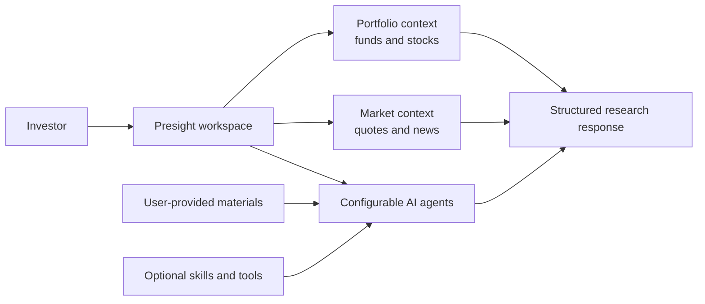

# Product architecture at a glance

This diagram describes the product concept, not the production deployment or internal implementation.

## Product ideas

- A question should be grounded in the relevant portfolio and market context, not only a generic chat prompt.
- User-provided research materials can complement public market information through retrieval-augmented generation (RAG).
- Skills and tools are capabilities an agent may select for a request; making one available does not mean it must run every time.
- Provider credentials and private account data belong behind authenticated server-side services, never in a browser bundle or public example.
- Market information may be delayed or estimated. The product should show source timing and distinguish estimates from confirmed values.

The JSON files in [`../examples/`](../examples/) are illustrative interface samples. They do not expose production APIs, provider routing, data-source adapters, or deployment details.
